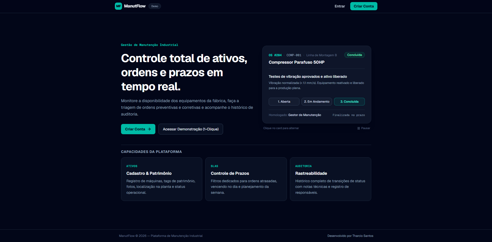
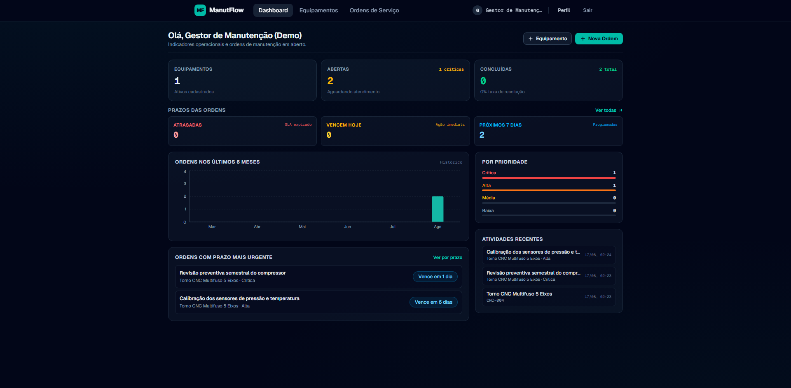

# ManutFlow

Sistema de Gestão de Ativos e Controle de Manutenção Industrial — full stack com Next.js 16, Supabase, TypeScript e Tailwind CSS.

O ManutFlow foi desenvolvido para equipes operacionais e gestores de manutenção que necessitam cadastrar máquinas e equipamentos, rastrear histórico de intervenções e acompanhar ordens de serviço e prazos (SLAs) com precisão técnica, substituindo planilhas manuais e processos descentralizados.

---

## Funcionalidades

### Página Inicial & Demonstração Interativa (Pública)
- **Hero Institucional**: Apresentação clara da proposta de valor, acesso rápido ao login e registro.
- **Simulador Interativo de Manutenção (Live Interactive Flow)**: Demonstração em tempo real das 3 etapas de uma ordem de manutenção (*Aberta, Em Andamento, Concluída*) com ficha técnica, patrimônio do ativo e auditoria de status, sem necessidade de autenticação prévia.
- **Capacidades Operacionais**: Cards técnicos detalhando controle de inventário, conformidade de prazos e rastreabilidade.
- **Renderização Condicional**: Landing Page para visitantes; Dashboard Operacional para usuários autenticados, na mesma rota `/`.

### Dashboard Operacional
- **Indicadores**: Total de equipamentos, ordens abertas e concluídas.
- **Controle de Prazos (SLAs)**: Ordens atrasadas, vencendo hoje e nos próximos 7 dias.
- **Atalhos Inteligentes**: Filtros de prazo acionados com 1 clique diretamente dos cards de métricas.
- **Ordens Urgentes**: Destaque das 3 ordens com prazo mais crítico.
- **Gráfico Mensal (Recharts)**: Volume de ordens dos últimos 6 meses.
- **Ordens Recentes**: Últimas ordens criadas, com ativo e data.
- **Taxa de Conclusão**: Percentual de ordens fechadas sobre o total.
- **Auto-refresh**: Recarga dos dados ao retornar o foco para a aba (`visibilitychange`).

### Equipamentos & Ativos
- **CRUD Completo**: Cadastro, edição via modal, listagem e exclusão controlada.
- **Ficha Técnica & Patrimônio**: Identificação única por `patrimony_code` (único por usuário), localização e status operacional.
- **Upload de Fotos**: Supabase Storage (JPEG, PNG, WebP até 5 MB) com preview e miniatura.
- **Página de Detalhes**: Dados do ativo e listagem das ordens de serviço vinculadas.
- **Proteção de Integridade**: Exclusão bloqueada quando existe ordem de serviço vinculada (garantida por `ON DELETE RESTRICT` no banco).
- **Filtros e Paginação**: Busca textual (nome, código, localização), filtro por status e paginação server-side.

### Ordens de Serviço
- **Abertura & Vinculação**: Ordens associadas a um equipamento do próprio usuário, com prioridade (`low`, `medium`, `high`, `critical`) e prazo opcional.
- **Gestão de Prazos**: Indicadores visuais de SLA (Atrasada, Vence hoje, Próximos 7 dias, Sem prazo) calculados no fuso `America/Sao_Paulo`.
- **Alteração Rápida de Status**: Seletor inline com atualização imediata.
- **Histórico & Auditoria**: Rastreabilidade das alterações de status e de prazo (histórico append-only).
- **Página de Detalhes da Ordem**: Dados do ativo associado, ajuste de prazo e linha do tempo de eventos.

### Perfil do Usuário
- Gestão de dados pessoais: nome completo, cargo/função e telefone.
- E-mail e data de cadastro somente leitura.

### Segurança & Arquitetura
- **Autenticação SSR**: Supabase Auth com sessão em cookies e renovação via `proxy.ts`.
- **Proteção de Rotas**: `proxy.ts` (convenção do Next.js 16) com proteção contra Open Redirect no callback.
- **Row Level Security (RLS)**: políticas de dono (`user_id = auth.uid()`) em `equipments`, `service_orders` e `service_order_history`, versionadas em `supabase/migrations`. O papel `anon` não tem GRANT nas tabelas de dados.
- **Autorização em Duas Camadas**: validação na API e trigger no banco impedindo que uma ordem aponte para equipamento de outro usuário.
- **Validação Server-Side**: tipo, tamanho e enum em todas as rotas, além de verificação de propriedade dos arquivos no Storage.
- **Rate Limiting**: proteção contra abusos em mutações e uploads (10–30 requisições/min por usuário). Implementado em memória — em ambiente serverless o limite é por instância.
- **Logging Estruturado**: logger em formato JSON para auditoria técnica.

---

## Preview do Sistema

### Landing Page e Dashboard

<p align="center">
  
  
</p>

---

## Stack Tecnológica

| Camada | Tecnologia | Finalidade |
|---|---|---|
| **Framework** | Next.js 16 (App Router) | Renderização híbrida SSR/Client, rotas dinâmicas e Server Components |
| **Linguagem** | TypeScript 5 (Strict Mode) | Tipagem estática rigorosa e segurança em tempo de compilação |
| **Estilização** | Tailwind CSS 4 | Design minimalista e responsivo |
| **Banco de Dados** | PostgreSQL (Supabase) | Armazenamento relacional com constraints, índices e RLS |
| **Autenticação** | Supabase Auth (SSR) | Sessões com cookies e JWT |
| **Storage** | Supabase Storage | Fotos de equipamentos com controle de permissão |
| **Gráficos** | Recharts | Gráfico de barras do volume mensal de ordens |
| **Ícones** | Lucide React | Ícones funcionais |
| **Testes** | Vitest + Testing Library | 176 testes automatizados em 17 arquivos |
| **Qualidade** | ESLint 9 (Flat Config) | Padronização e análise estática de código |

---

## Banco de Dados

Schema versionado em [`supabase/migrations`](supabase/migrations). O runbook de aplicação, verificação e rollback está em [`supabase/README.md`](supabase/README.md).

| Tabela | Conteúdo |
|---|---|
| `profiles` | Dados do usuário (nome, cargo, telefone), criada automaticamente no signup |
| `equipments` | Ativos, com `patrimony_code` único por usuário |
| `service_orders` | Ordens de serviço, com CHECK nos enums de status e prioridade |
| `service_order_history` | Eventos de auditoria (append-only) |

- RLS habilitada com políticas de dono nas três tabelas de dados.
- Trigger `enforce_order_equipment_owner` impede ordem vinculada a ativo de outro usuário.
- Bucket `equipment-photos` no Storage, com pasta por `user_id`.

---

## Páginas & Rotas

| Rota | Acesso | Descrição |
|---|---|---|
| `/` | Público / Autenticado | Landing Page para visitantes; Dashboard operacional para usuários logados |
| `/equipamentos` | Autenticado | Gestão de equipamentos com busca, filtro de status, upload e paginação |
| `/equipamentos/[id]` | Autenticado | Ficha do ativo com as ordens de serviço vinculadas |
| `/ordens` | Autenticado | Central de ordens com filtros combinados de status, prioridade e SLA |
| `/ordens/[id]` | Autenticado | Detalhes da ordem, ajuste de prazo e linha do tempo de auditoria |
| `/perfil` | Autenticado | Dados cadastrais do operador |
| `/login` | Público | Autenticação com e-mail/senha e acesso demo em 1 clique |
| `/register` | Público | Criação de conta |

---

## Rotas de API

| Método | Rota | Descrição |
|---|---|---|
| `GET` | `/api/health` | Verificação de disponibilidade do serviço |
| `GET` | `/api/dashboard-summary` | Totais, prazos, ordens urgentes e gráfico mensal |
| `GET` | `/api/equipments` | Listagem paginada com filtros e busca |
| `POST` | `/api/equipments` | Cadastro de equipamento |
| `GET` | `/api/equipments/[id]` | Ativo específico e suas ordens |
| `PATCH` | `/api/equipments/[id]` | Edição parcial do equipamento |
| `DELETE` | `/api/equipments/[id]` | Exclusão (bloqueada se houver ordens vinculadas) |
| `GET` | `/api/service-orders` | Listagem paginada com filtros de status, prioridade e prazo |
| `POST` | `/api/service-orders` | Abertura de ordem (valida titularidade do equipamento) |
| `GET` | `/api/service-orders/[id]` | Ordem com ativo vinculado e histórico |
| `PATCH` | `/api/service-orders/[id]` | Atualização de status e/ou prazo com registro no histórico |
| `DELETE` | `/api/service-orders/[id]` | Exclusão da ordem |
| `GET` | `/api/profile` | Dados do perfil autenticado |
| `PATCH` | `/api/profile` | Atualização de nome, cargo e telefone |
| `POST` | `/api/upload` | Upload de imagem (JPEG/PNG/WebP, até 5 MB, 10/min) |
| `DELETE` | `/api/upload` | Remoção de foto no bucket |
| `GET` | `/auth/callback` | Troca de código por sessão (OAuth/magic link) |

---

## Estrutura de Pastas

```
manutflow/
├── src/
│   ├── app/
│   │   ├── api/                   # Route Handlers REST
│   │   ├── auth/callback/         # Troca de código por sessão
│   │   ├── equipamentos/          # Listagem e detalhes de ativos
│   │   ├── ordens/                # Listagem e detalhes de ordens
│   │   ├── perfil/                # Perfil do usuário
│   │   ├── login/ & register/     # Autenticação
│   │   ├── page.tsx               # Landing Page ou Dashboard conforme a sessão
│   │   ├── layout.tsx             # Layout raiz
│   │   └── globals.css            # Tailwind CSS + tema
│   ├── components/
│   │   ├── landing/               # LandingHeader, DemoMaintenanceFlow, FeatureCard
│   │   ├── layout/                # AppShell, AppHeader
│   │   └── ui/                    # Modal, StatusCard, Pagination, Toolbar, Breadcrumbs
│   ├── features/
│   │   ├── dashboard/             # Overview, métricas de SLA, gráfico e atividades
│   │   ├── equipments/            # Formulários, listagens e config de status
│   │   └── service-orders/        # Gestão de ordens, badges de prazo e histórico
│   ├── lib/
│   │   ├── auth.ts                # Sessão e autenticação das APIs
│   │   ├── validation.ts          # Validação de UUID
│   │   ├── rate-limit.ts          # Rate limiting em memória
│   │   ├── logger.ts              # Logger estruturado em JSON
│   │   ├── equipment-photo-storage.ts  # Ownership e remoção de fotos
│   │   ├── fetch-with-retry.ts    # Retry para chamadas do client
│   │   ├── safe-redirect.ts       # Proteção contra Open Redirect
│   │   └── supabase/              # Clientes Supabase (Browser, Server, Middleware)
│   ├── types/                     # Tipos de domínio (equipment, service-order, profile)
│   └── proxy.ts                   # Proxy do Next.js 16 para renovação de sessão
├── supabase/
│   ├── migrations/                # Schema versionado (baseline + RLS)
│   └── README.md                  # Runbook de migrations
└── public/
    └── previews/                  # Capturas usadas neste README
```

---

## Demonstração Online

- **Aplicação publicada:** [https://manutflow.vercel.app](https://manutflow.vercel.app)
- **Repositório oficial:** [https://github.com/tharciosantos/manutflow](https://github.com/tharciosantos/manutflow)

### Acesso Rápido Demo (1-Clique)

Na tela de login, o botão **"Acessar como Gestor (Demo)"** preenche as credenciais da conta `demo@manutflow.com` e entra com ativos, ordens e histórico já cadastrados.

---

## Como Executar Localmente

### Pré-requisitos

- Node.js 20+ (o CI usa a versão 22)
- Projeto Supabase configurado

### Passo a passo

```bash
# 1. Clonar o repositório
git clone https://github.com/tharciosantos/manutflow.git
cd manutflow

# 2. Instalar dependências
npm install

# 3. Configurar variáveis de ambiente
cp .env.example .env.local        # Linux/macOS
Copy-Item .env.example .env.local # PowerShell

# 4. Iniciar servidor de desenvolvimento
npm run dev                       # http://localhost:3000
```

O Next.js lê tanto `.env` quanto `.env.local` — use o que preferir.

### Variáveis de Ambiente

```env
NEXT_PUBLIC_SUPABASE_URL=https://seu-projeto.supabase.co
NEXT_PUBLIC_SUPABASE_ANON_KEY=sua-chave-anonima
SUPABASE_SERVICE_ROLE_KEY=sua-service-role-key  # apenas no servidor: upload e remoção de fotos
```

### Banco de dados em um projeto novo

```bash
supabase link --project-ref <PROJECT_REF>
supabase db push        # aplica supabase/migrations
```

Detalhes e verificação em [`supabase/README.md`](supabase/README.md).

---

## Testes & Qualidade

```bash
npm run test          # todos os testes (Vitest)
npm run test:watch    # modo watch
npx tsc --noEmit      # checagem estática de tipos
npm run lint          # ESLint
npm run build         # build de produção
```

**Suíte de testes:** 176 testes automatizados em 17 arquivos, cobrindo rotas de API, autenticação, cálculos de SLA, rate limiting, storage e componentes de interface.

---

## Fases Implementadas

| # | Fase | Descrição |
|:-:|---|---|
| 0–13 | **Core & Evolução** | CRUD de equipamentos, upload no Storage, filtros combinados, gestão de prazos (SLAs), rate limiting, auditoria e testes automatizados. |
| 14 | **Modernização Visual & Landing Page** | Landing Page pública com simulador interativo, redesign minimalista B2B e modos claro/escuro. |
| 15 | **Segurança & Versionamento do Schema** | RLS com políticas de dono, remoção de políticas legadas permissivas, trigger anti-IDOR, validação de titularidade na API e migrations versionadas. |
